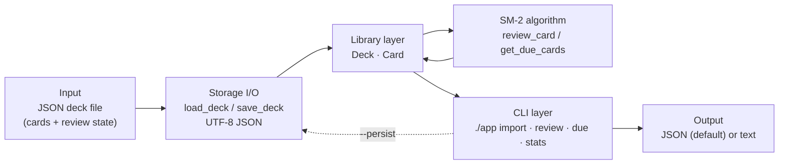

# Flashcard Scheduler

A small Python library and command-line tool that schedules JSON flashcards with
the **SM-2 (SuperMemo 2)** spaced repetition algorithm. All dates are supplied
explicitly by the caller — the tool never reads the system clock.

## Architecture



The CLI is a thin adapter: it parses arguments, calls the library, maps errors
to exit codes, and renders the result. The library has no I/O beyond
`load_deck` / `save_deck`; the SM-2 module is pure and functional.

## Install

The project has **zero runtime dependencies** and targets Python 3.10+. The
`./app` wrapper resolves the package relative to its own location, so it runs
straight from a checkout:

```bash
./app --version
```

Optionally install it as a package (adds a `flashcard-scheduler` console
script):

```bash
pip install -e .
```

For development and the test/lint tooling:

```bash
pip install -e ".[dev]"
```

Because there are no third-party runtime packages, there is no `./setup`
script; nothing needs to be installed before `./app` can be used.

## Usage

```
./app import <deck.json> [--reference-date <YYYY-MM-DD>]
./app review <deck.json> <card-id> <grade> [--reference-date <YYYY-MM-DD>] [--persist]
./app due <deck.json> --reference-date <YYYY-MM-DD> [--json]
./app stats <deck.json> [--json]
./app --version
./app --help
```

| Argument | Required | Description |
|---|---|---|
| `<deck.json>` | yes | JSON file containing the deck and review history |
| `<card-id>` | review | case-sensitive card identifier |
| `<grade>` | review | integer `0`–`5` (0 = blackout, 5 = perfect) |
| `--reference-date` | review, due | explicit "today" as `YYYY-MM-DD`; never inferred |
| `--persist` | no | write the updated deck back to disk after `review` |
| `--json` | no | JSON output for `due` and `stats` (`import`/`review` are JSON already) |

### Exit codes

Precedence: `2` > `1` > `0`.

| Code | Meaning |
|---|---|
| `0` | success |
| `1` | logical error (card not found, duplicate `card_id`) |
| `2` | I/O, JSON parse, argument, or date-format error |

Errors are written to `stderr` as `error: <message>`; `stdout` is empty on
error. On success, all output goes to `stdout`.

## Examples

### 1. Import (validate and normalize) a deck

```bash
$ ./app import deck.json
{
  "name": "Spanish 101",
  "cards": [
    {
      "card_id": "word-1",
      "front": "hola",
      "back": "hello",
      "ef": 2.5,
      "interval": 0,
      "reps": 0,
      "last_review": null,
      "next_review": null,
      "created_at": "2026-01-01"
    }
  ]
}
```

Malformed JSON exits `2`; duplicate card ids exit `1`.

### 2. Review a card with grade progression

```bash
$ ./app review deck.json word-1 4 --reference-date 2026-01-15 --persist
{
  "card_id": "word-1",
  ...
  "ef": 2.5,
  "interval": 1,
  "reps": 1,
  "last_review": "2026-01-15",
  "next_review": "2026-01-16",
  "created_at": "2026-01-01"
}

$ ./app review deck.json word-1 5 --reference-date 2026-01-16 --persist
# ef -> 2.6, interval -> 6, next_review -> 2026-01-22

$ ./app review deck.json word-1 5 --reference-date 2026-01-22
# reps -> 3, interval -> ceil(6 * 2.6) = 16, next_review -> 2026-02-07

$ ./app review deck.json word-1 2 --reference-date 2026-02-07
# failure: reps -> 0, ef -> 2.28, interval -> 1, next_review -> 2026-02-08
```

### 3. Query due cards

```bash
$ ./app due deck.json --reference-date 2026-01-15
vocab-1: gato
vocab-3: perro

$ ./app due deck.json --reference-date 2026-01-15 --json
[
  {
    "card_id": "vocab-1",
    "front": "gato",
    ...
  }
]
```

With no due cards the text output is `no cards due` and the JSON output is
`[]`.

### 4. Aggregate statistics

```bash
$ ./app stats deck.json
average_ef: 2.47
learned_cards: 5
learning_cards: 2
name: My Spanish Deck
new_cards: 3
total_cards: 10
```

## SM-2 Algorithm

For a review with quality `q` in `[0, 5]` on `reference_date`:

1. **Repetitions.** If `q >= 3`, `n' = n + 1`; otherwise `n' = 0` (the card is
   considered forgotten and restarts).
2. **Ease factor.**
   `EF' = EF + (0.1 - (5 - q) * (0.08 + (5 - q) * 0.02))`, clamped to a minimum
   of `1.3`.
3. **Interval.**
   - `n' = 0` (or the card was new, `n = 0`): 1 day
   - `n' = 1`: 1 day
   - `n' = 2`: 6 days
   - `n' >= 3`: `ceil(I * EF)` using the card's ease factor before this review
     (this is the value pinned by the acceptance criteria: `ceil(6 * 2.6) = 16`,
     `ceil(100 * 2.8) = 280`)
4. **Dates.** `last_review = reference_date`,
   `next_review = reference_date + I' days`. The interval is never less than one
   day.

Defaults and why they exist:

- **Initial EF 2.5.** SuperMemo's empirically chosen starting point: a card at
  EF 2.5 grows by roughly 2.5× per successful repetition once past the early
  repetitions.
- **Minimum EF 1.3.** Prevents "ease hell": a card answered badly many times
  cannot collapse to an impossibly small interval.
- **Intervals 1 and 6 days.** The first two successful repetitions use fixed
  short intervals; only from the third repetition does the interval scale with
  the ease factor. This gives quick early reinforcement before longer gaps.

`ef` is stored with full calculation precision but serialized cleanly (binary
floating-point noise such as `2.2799999999999994` is removed). `stats` rounds
`average_ef` to two decimals.

## Supported features (v0.1)

- JSON deck import with validation and normalization.
- SM-2 review scheduling (`review`) with optional `--persist`.
- Due-card queries (`due`) in text or JSON, ordered by `next_review` then
  `card_id`.
- Aggregate deck statistics (`stats`) in text or JSON.
- Explicit dates everywhere: no `datetime.now()` or `time.time()`.
- Deterministic JSON output with 2-space indentation.

Non-objectives — deliberately **not** implemented in v0.1:

1. Real-time clock / automatic "today" inference.
2. Scheduling algorithms other than SM-2 (Leitner, Anki, custom variants).
3. Generative AI, NLP, card generation, hints, or suggestions.
4. PDF parsing.
5. Web UI or GUI.
6. Multi-user support, authentication, cloud sync, or conflict resolution.
7. Sub-day intervals, custom spacing, tags, or hierarchies.
8. Concurrency or file locking.
9. Analytics or progress tracking over time.
10. Backup, versioning, or undo.
11. Export formats other than JSON (PDF, CSV, Anki).
12. Batch review (one card per `review` call).

## How this was built

The **specification was written first** (see issue #1, including the v0.1.1
clarifications and the v0.1.2 delivery contract). The **implementation was
written by an autonomous AI agent** running in an internal harness — there were
no human edits to the code. The **black-box acceptance tests were written by a
separate, independent AI agent**, working from the specification only; those
tests live outside this repository and are executed by the harness. The public
test suite in `tests/` mirrors the acceptance criteria and uses the same
black-box approach (subprocess calls to `./app`, no imports of the
implementation).

Flow: **spec → implementation → independent tests**. Points the spec left open
were resolved conservatively and documented here or in code comments — for
example, the exact snippet in an `invalid JSON at line n: ...` message, the
pretty-printing newline, `average_ef` for an empty deck (reported as `0.0`), and
the interval computation using the pre-review ease factor (the one consistent
with AC-3 and AC-21).

## Tests

Run the public black-box suite from the repository root:

```bash
python -m pytest
```

The suite invokes `./app` as a subprocess and covers AC-1…AC-22 plus the
documented edge cases. Fixtures live in `tests/fixtures/`.

## Lint

```bash
ruff check .
```

Configuration is in `pyproject.toml`.

## CI

`.github/workflows/ci.yml` runs lint and the test suite on every push and pull
request, with a Python 3.10/3.11/3.12 matrix.

## Release

Version `0.1.0` is tagged `v0.1.0` and released by the maintainer after the
implementation is merged. The repository at the tag commit is the release
artifact.

## License

MIT — see [LICENSE](LICENSE).
